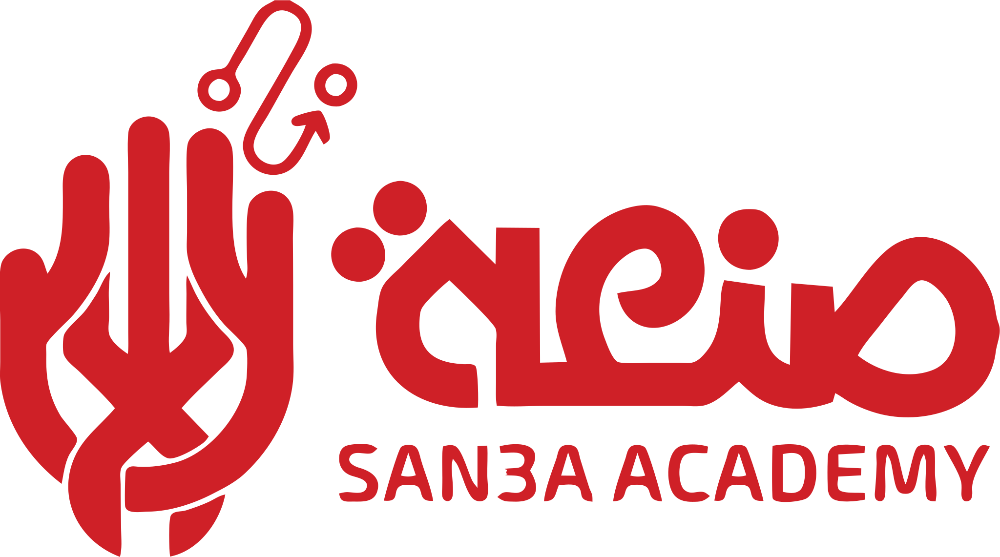

# San3a Academy Media Kit

Edition 1.0, November 2026



Brand and press reference for San3a Academy: company descriptions, logos, colours, typography, CSS and social assets.

Items marked **[ADD: …]** still need to be completed.

## Contents

1. [About](#1-about)
2. [Logo](#2-logo)
3. [Colour](#3-colour)
4. [Typography](#4-typography)
5. [CSS and components](#5-css-and-components)
6. [Social assets and favicons](#6-social-assets-and-favicons)
7. [Editorial style](#7-editorial-style)
8. [Use and contact](#8-use-and-contact)

---

## 1. About

### Company descriptions

**One line** (bios and captions)

> San3a Academy teaches hands-on technology through project-based courses in creative coding, electronics, IoT and physical AI.

**Short** (event listings and directories)

> San3a Academy is a technology education academy built around making. Learners work through hands-on courses in creative coding, ESP32 and IoT, physical AI, and hardware and software debugging, then document and present the projects they build. An Employability track supports learners in building practical career skills.

**Full** (press articles and proposals)

> San3a Academy takes its name from صنعة, the Arabic word for a craft or trade, and teaches technology the way a craft is learned: by making things. Courses range from creative coding with micro:bit to ESP32 development, IoT and physical AI. Learners identify real-world problems, build working hardware and software prototypes, and document the journey in final project journals they present in a showcase. Debugging Fundamentals teaches systematic troubleshooting, and the Employability track builds practical career skills. Learners stay connected through the academy's Discord community.

**Arabic**

> صنعة أكاديمية لتعليم التكنولوجيا من خلال التطبيق العملي. يتعلّم الدارسون البرمجة الإبداعية والإلكترونيات وإنترنت الأشياء والذكاء الاصطناعي الفيزيائي عبر دورات قائمة على المشروعات، ثم يوثّقون ما يصنعونه ويعرضونه.

### Fact sheet

| Item | Detail |
| :--- | :--- |
| Name | San3a Academy |
| Arabic name | صنعة |
| Meaning | Craft, trade or skilled making |
| Sector | Technology and maker education |
| Website | [www.san3a.academy](https://www.san3a.academy) |
| Community | [Discord](https://discord.gg/ZDYnw4Zkb) |
| Founded | **[ADD: founding year]** |
| Headquarters | **[ADD: city and country]** |
| Leadership | **[ADD: founder or CEO name and title]** |
| Learners to date | **[ADD: verified figure and date]** |
| Partners | **[ADD: approved partner names]** |

### Programs

| Program | Area | Description |
| :--- | :--- | :--- |
| Code & Create | Creative coding | Creative coding challenges, micro:bit projects and a final project showcase, under the Zero to Maker banner. |
| Debugging Fundamentals | Troubleshooting | Systematic hardware and software troubleshooting with guided practice. |
| Employability | Career skills | Practical skills, cohort onboarding and learner orientation. |
| Physical AI for Beginners | AI | An entry-level course in physical AI. |
| ESP32 Hybrid Course | Embedded | ESP32 development in a hybrid format. |
| IoT Explorers Bootcamp | IoT | A bootcamp in connected devices and the Internet of Things. |

---

## 2. Logo

The logo shows a maker's hand, wired to an idea, beside the Arabic word صنعة. Use the full logo wherever it fits, and the symbol alone where space is tight.

> **Source note:** these vectors were traced from the only available logo file, a 230×130 PNG. Replace them with the designer's original artwork if it becomes available, especially for print and signage.

### Files

Use SVG for anything that scales. PNG files are 2048 px wide with transparent backgrounds.

| Version | Best for | Red | White | Ink |
| :--- | :--- | :--- | :--- | :--- |
| Primary logo | Almost every use | [SVG](logos/svg/san3a-primary-red.svg) · [PNG](logos/png/san3a-primary-red-2048.png) | [SVG](logos/svg/san3a-primary-white.svg) · [PNG](logos/png/san3a-primary-white-2048.png) | [SVG](logos/svg/san3a-primary-ink.svg) · [PNG](logos/png/san3a-primary-ink-2048.png) |
| Symbol | Avatars, app icons, tight spaces | [SVG](logos/svg/san3a-symbol-red.svg) · [PNG](logos/png/san3a-symbol-red-2048.png) | [SVG](logos/svg/san3a-symbol-white.svg) · [PNG](logos/png/san3a-symbol-white-2048.png) | [SVG](logos/svg/san3a-symbol-ink.svg) · [PNG](logos/png/san3a-symbol-ink-2048.png) |
| Bilingual wordmark | When the symbol already appears nearby | [SVG](logos/svg/san3a-wordmark-red.svg) · [PNG](logos/png/san3a-wordmark-red-2048.png) | [SVG](logos/svg/san3a-wordmark-white.svg) · [PNG](logos/png/san3a-wordmark-white-2048.png) | [SVG](logos/svg/san3a-wordmark-ink.svg) · [PNG](logos/png/san3a-wordmark-ink-2048.png) |
| Arabic wordmark | Arabic-only layouts | [SVG](logos/svg/san3a-arabic-red.svg) · [PNG](logos/png/san3a-arabic-red-2048.png) | [SVG](logos/svg/san3a-arabic-white.svg) · [PNG](logos/png/san3a-arabic-white-2048.png) | [SVG](logos/svg/san3a-arabic-ink.svg) · [PNG](logos/png/san3a-arabic-ink-2048.png) |
| Latin wordmark | English-only lines, small credits | [SVG](logos/svg/san3a-latin-red.svg) · [PNG](logos/png/san3a-latin-red-2048.png) | [SVG](logos/svg/san3a-latin-white.svg) · [PNG](logos/png/san3a-latin-white-2048.png) | [SVG](logos/svg/san3a-latin-ink.svg) · [PNG](logos/png/san3a-latin-ink-2048.png) |

### Clear space

X is the diameter of the large dot in the Arabic wordmark. Keep at least 2X free of text, images and page edges on every side of the logo.

### Minimum size

| Version | Screen | Print |
| :--- | :--- | :--- |
| Full logo | 120 px wide | 30 mm wide |
| Symbol | 24 px tall | 8 mm tall |
| Arabic wordmark | 72 px wide | 18 mm wide |

### Backgrounds

| Logo colour | Use on |
| :--- | :--- |
| Red | White, Paper |
| White | Ink, Red, Wine, brand gradient |
| Ink | Sun, Blush |

### Logo misuse

- Don't stretch or squash the logo.
- Don't rotate or tilt it.
- Don't change it to an unapproved colour.
- Don't add shadows, glows or outlines.
- Don't place the red logo on dark brand colours. Use the white logo.
- Don't place it on busy imagery or patterns.

---

## 3. Colour

### Core

| Name | Hex | RGB | HSL | CMYK | CSS token | Use |
| :--- | :--- | :--- | :--- | :--- | :--- | :--- |
| Red | `#CF2027` | 207 32 39 | 358° 73% 47% | 0 85 81 19 | `--s3-red` | Signature colour, logo and main actions |
| Wine | `#781629` | 120 22 41 | 348° 69% 28% | 0 82 66 53 | `--s3-wine` | Hover states and depth |
| Maroon | `#3D1221` | 61 18 33 | 339° 54% 15% | 0 70 46 76 | `--s3-maroon` | Dark surfaces and gradients |
| Ink | `#240D18` | 36 13 24 | 331° 47% 10% | 0 64 33 86 | `--s3-ink` | Text and darkest backgrounds |

### Surfaces and accents

| Name | Hex | RGB | HSL | CMYK | CSS token | Use |
| :--- | :--- | :--- | :--- | :--- | :--- | :--- |
| Paper | `#FFF7F3` | 255 247 243 | 20° 100% 98% | 0 3 5 0 | `--s3-paper` | Default page background |
| Blush | `#F9DFE1` | 249 223 225 | 355° 68% 93% | 0 10 10 2 | `--s3-blush` | Tints and soft fills |
| Sun | `#FFC93C` | 255 201 60 | 43° 100% 62% | 0 21 76 0 | `--s3-sun` | Highlights and calls to action on dark |
| Teal | `#2EC4B6` | 46 196 182 | 174° 62% 47% | 77 0 7 23 | `--s3-teal` | Success and focus states |

CMYK values are mathematical conversions from the screen colours. Get a printed proof before a large run.

### Recommended balance

| Share | Colours |
| :--- | :--- |
| 55% | Paper or White |
| 20% | Ink |
| 20% | Red |
| 5% | Sun and Teal accents |

### Gradients

| Token | Definition |
| :--- | :--- |
| `--s3-gradient-brand` | 135°, Ink → Maroon (55%) → Wine |
| `--s3-gradient-heat` | 135°, Wine → Red |
| `--s3-gradient-signal` | 90°, Ink → Wine → Red → Sun |

### Accessible pairings

| Text on background | Contrast | WCAG result |
| :--- | :--- | :--- |
| Ink on Paper | 17.33:1 | AAA, any text |
| Red on White | 5.40:1 | AA, any text |
| Red on Paper | 5.10:1 | AA, any text |
| White on Red | 5.40:1 | AA, any text |
| White on Wine | 10.79:1 | AAA, any text |
| White on Ink | 18.33:1 | AAA, any text |
| Sun on Ink | 11.93:1 | AAA, any text |
| Ink on Sun | 11.93:1 | AAA, any text |
| Ink on Teal | 8.46:1 | AAA, any text |
| Wine on Blush | 8.57:1 | AAA, any text |
| Red on Ink | 3.39:1 | Large text only |
| White on Teal | 2.17:1 | Avoid for text |

---

## 4. Typography

Use the licensed brand fonts in designed materials. On the web, or without a licence, use the free substitute.

| Role | Brand font | Web substitute |
| :--- | :--- | :--- |
| Headlines | Big John | Montserrat 700–900 |
| Sub-headlines | Arvo | Arvo 400–700 |
| Paragraphs and UI | Myriad Pro | Inter 400–700 |
| All Arabic text | GE SS | Cairo 400–800 |

### Type scale

| Token | Size | Use |
| :--- | :--- | :--- |
| `--s3-text-display` | 48–104 px, fluid | Covers and hero titles |
| `--s3-text-3xl` | 36–48 px, fluid | Page and section titles |
| `--s3-text-2xl` | 32 px | Major headings |
| `--s3-text-xl` | 24 px | Sub-headlines |
| `--s3-text-lg` | 20 px | Lead paragraphs |
| `--s3-text-md` | 16 px | Body text |
| `--s3-text-sm` | 14 px | Captions and tables |
| `--s3-text-xs` | 12 px | Labels and eyebrows |

---

## 5. CSS and components

[`san3a-brand.css`](san3a-brand.css) holds the colour, font, spacing and shadow tokens, plus ready-made components. Base typography applies only inside `.s3-theme`, and every component is prefixed `s3-`, so it won't change a site's existing styles.

To use the logo helpers, keep the `logos/` folder next to the stylesheet.

### Quick start

```html
<link rel="stylesheet" href="san3a-brand.css">

<body class="s3-theme">
  <span class="s3-logo" role="img" aria-label="San3a Academy"></span>
  <p class="s3-eyebrow">Now enrolling</p>
  <h1>Learn by making</h1>
  <a class="s3-btn s3-btn--primary" href="#">Join a course</a>
</body>
```

### Tokens in your own CSS

```css
.course-card {
  background: var(--s3-surface);
  color: var(--s3-text);
  padding: var(--s3-space-6);
  border-radius: var(--s3-radius-md);
  box-shadow: var(--s3-shadow-md);
  font-family: var(--s3-font-body);
}

.course-card h3 {
  font-family: var(--s3-font-subhead);
  color: var(--s3-red);
}
```

### Class reference

| Class | Purpose |
| :--- | :--- |
| `.s3-theme` | Applies brand fonts and colours to a page or container |
| `.s3-on-dark` | Switches semantic colours for dark surfaces |
| `.s3-ar` | Arabic font and right-to-left direction |
| `.s3-btn` with `--primary`, `--secondary`, `--ghost`, `--sun` | Buttons with a 44 px touch target |
| `.s3-card`, `.s3-card--raised` | Surfaces |
| `.s3-badge` with `--red`, `--sun`, `--teal`, `--ink` | Labels and status |
| `.s3-eyebrow` | Small uppercase section label |
| `.s3-input` | Text field |
| `.s3-signal-bar` | Ink-to-sun gradient divider |
| `.s3-logo`, `.s3-symbol` with `--white`, `--ink` | Logo as CSS. Resize with `--s3-logo-width` |

---

## 6. Social assets and favicons

| Asset | Size (px) | File |
| :--- | :--- | :--- |
| Avatar, Red | 1080 × 1080 | [PNG](social/san3a-avatar-red-1080.png) |
| Avatar, Ink | 1080 × 1080 | [PNG](social/san3a-avatar-ink-1080.png) |
| Avatar, Paper | 1080 × 1080 | [PNG](social/san3a-avatar-paper-1080.png) |
| Link preview | 1200 × 630 | [PNG](social/san3a-og-1200x630.png) |
| X header | 1500 × 500 | [PNG](social/san3a-x-header-1500x500.png) |
| LinkedIn banner | 1128 × 191 | [PNG](social/san3a-linkedin-banner-1128x191.png) |
| Facebook cover | 1640 × 624 | [PNG](social/san3a-facebook-cover-1640x624.png) |
| YouTube banner | 2560 × 1440 | [PNG](social/san3a-youtube-banner-2560x1440.png) |
| Story | 1080 × 1920 | [PNG](social/san3a-story-1080x1920.png) |

### Favicons

Files are in [`favicon/`](favicon/). Copy the folder to your site, then add:

```html
<link rel="icon" href="favicon/favicon.svg" type="image/svg+xml">
<link rel="icon" href="favicon/favicon-32.png" sizes="32x32" type="image/png">
<link rel="icon" href="favicon/favicon-192.png" sizes="192x192" type="image/png">
<link rel="apple-touch-icon" href="favicon/favicon-180.png">
```

---

## 7. Editorial style

Our voice is practical, encouraging and precise. We talk about what learners make, and we explain technical ideas without talking down.

### Writing our name

- Write **San3a Academy** on first mention and **San3a** after that.
- Write صنعة in Arabic text.
- The "3" stands for the Arabic letter ع and is always a numeral.

### Please avoid

- Sanaa Academy, Sana Academy or San'a Academy.
- SAN3A in running text. Capitals belong to the logo.
- San 3a or San-3a.
- Program names in lower case. Write Code & Create, with the ampersand.

---

## 8. Use and contact

Press, partners and community members may use these assets to refer to San3a Academy.

### Terms of use

- Use the assets for news, reviews, partner announcements and event listings.
- Keep the logo unaltered and follow this guide.
- Don't imply San3a Academy's endorsement or sponsorship without written approval.
- Don't use the name or logo in your own product, company or domain name.

### Press contact

- **[ADD: contact name and role]**
- **[ADD: press email]**
- **[ADD: phone or WhatsApp]**
- **[ADD: official social profile links]**
- **[ADD: link to press photos]**
- Website: [www.san3a.academy](https://www.san3a.academy)

---

© 2026 San3a Academy. All rights reserved.
